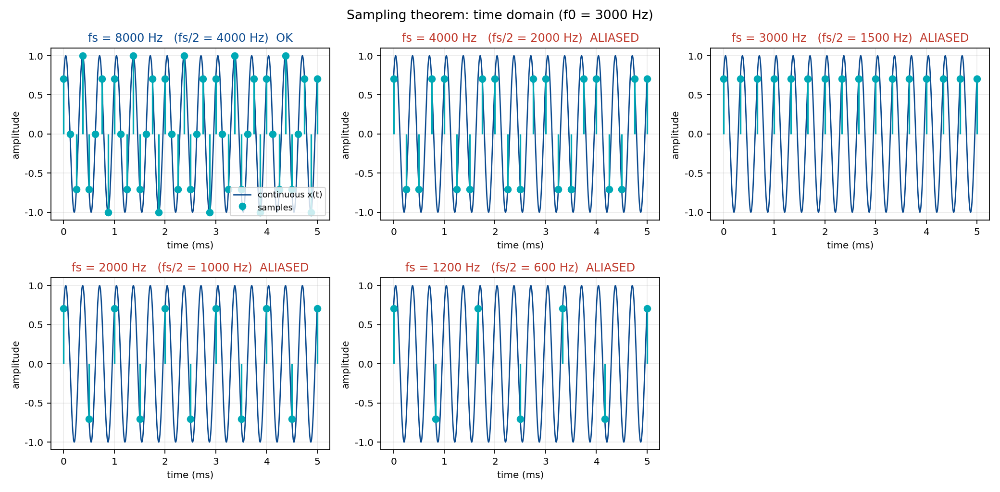
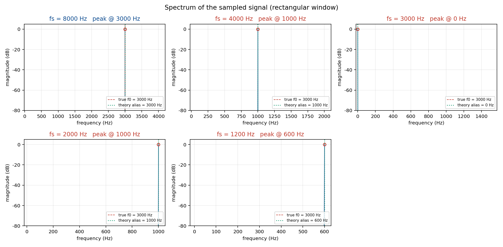
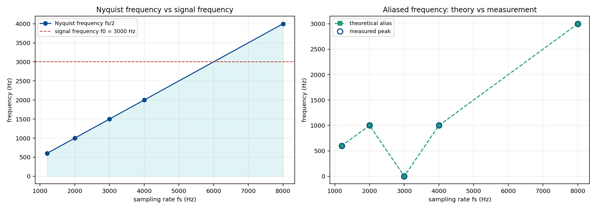
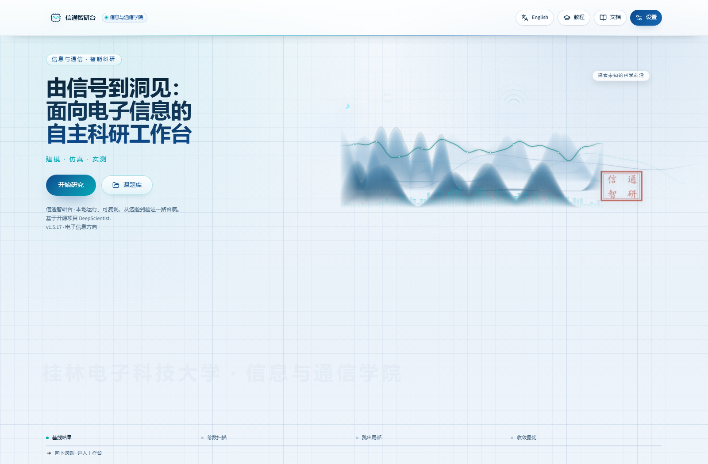
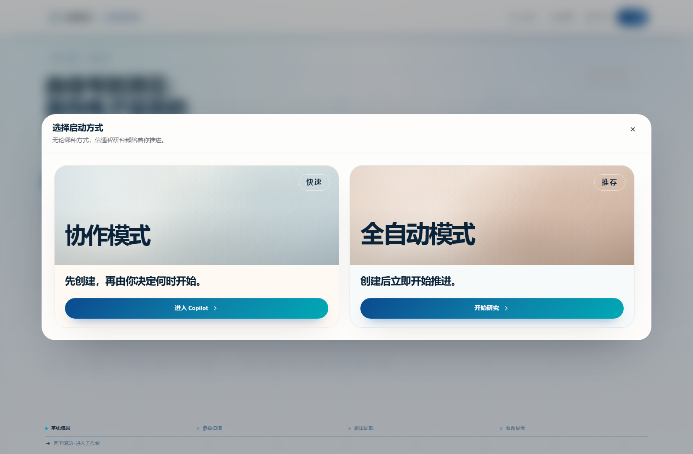
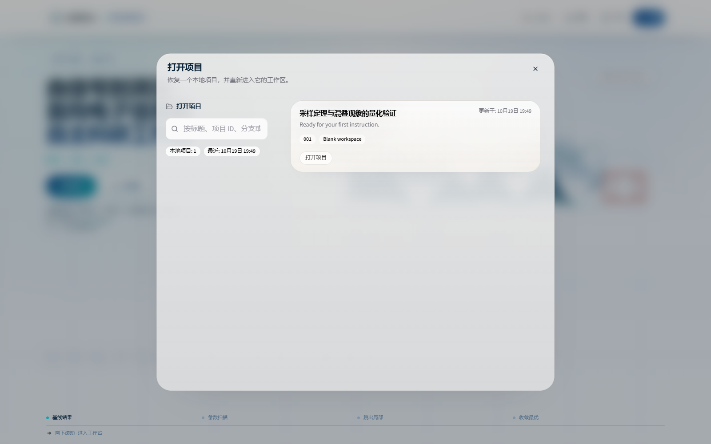
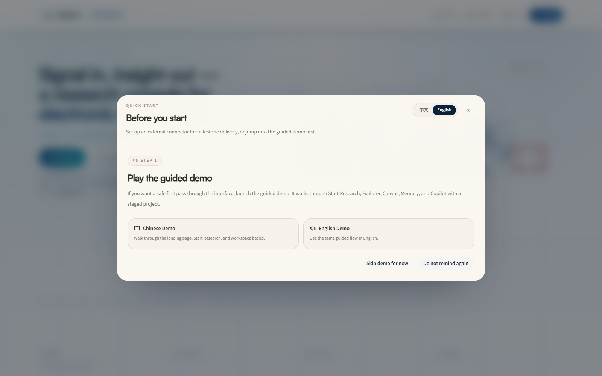

# 信通智研台 · DeepScientist 前端改造与可行性验证

把开源科研工作台 **DeepScientist 1.5.17** 的前端改造为「信通智研台 · 桂林电子科技大学信息与通信学院」
品牌皮肤，并用一个真实的信号与系统实验，验证**改造后系统是否仍然可用**。

> 结论先说：**前端改造是安全的**，页面 / 弹窗 / 课题库 / 接口 / 课题生命周期全部正常；
> 但**原生 Windows 上让它自动跑完一个课题目前跑不通**，卡点在运行时自检与 MCP 工具，不在前端。
> 详见 [`reports/02-前端改造可行性验证报告.md`](reports/02-前端改造可行性验证报告.md)。

---

## 一、改造做了什么

只替换前端静态资源，**没有修改任何后端代码和业务逻辑**：

| 文件 | 作用 |
|---|---|
| `frontend/brand.css` | 外部覆盖样式：桂电蓝 `#0B4A8F` + 信号青 `#00A9B5`，频谱山峦主视觉、按钮与弹窗配色 |
| `frontend/brand.js` | 运行时文案替换（中英两套映射）、标签页标题、印章与示波器装饰层 |
| `frontend/deploy.py` | 一键把皮肤注入 `src/ui/dist/`，并备份原始文件 |
| `frontend/restore.py` | 一键回滚 |
| `frontend/assets/` | 替换用的 Logo、favicon、主视觉、印章 |

**设计原则**：全部是"叠加"，不删除、不重写原有 DOM 与脚本，因此不改变业务行为。

## 二、实验验证了什么

`experiments/aliasing/` 是一个可完全本地复现的数值实验：

**采样定理与混叠现象的量化验证** —— f0 = 3000 Hz，采样率取 8000 / 4000 / 3000 / 2000 / 1200 Hz，
用 FFT 实测谱峰位置，与折叠公式 `f_alias = |f0 − k·fs|` 逐组对照。

结果（五组误差全部为 0 Hz）：

| fs (Hz) | 奈奎斯特 (Hz) | 满足采样定理 | 理论混叠 (Hz) | 实测峰值 (Hz) |
|---:|---:|:---:|---:|---:|
| 8000 | 4000 | 是 | 3000 | 3000 |
| 4000 | 2000 | 否 | 1000 | 1000 |
| 3000 | 1500 | 否 | 0 | 0 |
| 2000 | 1000 | 否 | 1000 | 1000 |
| 1200 | 600 | 否 | 600 | 600 |





完整报告见 [`reports/01-采样定理与混叠-实验报告.md`](reports/01-采样定理与混叠-实验报告.md)。

## 三、目录结构

```
├── frontend/          前端皮肤源码与部署脚本
│   ├── brand.css
│   ├── brand.js
│   ├── deploy.py
│   ├── restore.py
│   └── assets/
├── tools/             素材生成与截图工具（PIL 生成主视觉、CDP 截图）
├── scripts/           启停脚本
├── experiments/
│   └── aliasing/      采样定理实验：脚本 + 三张图 + CSV/JSON + 结果表
├── reports/
│   ├── 01-采样定理与混叠-实验报告.md
│   ├── 02-前端改造可行性验证报告.md
│   └── images/        验证过程截图
└── patches/
    └── 0001-fix-codex-mcp-toml-escaping.patch
```

## 四、界面预览

| 首页 | 启动方式 |
|---|---|
|  |  |

| 课题库 | 首次引导（未本地化） |
|---|---|
|  |  |

## 五、怎么用

### 部署皮肤

```bash
# 先备份再注入（脚本内部会自动备份原始文件）
python frontend/deploy.py
```

### 回滚

```bash
python frontend/restore.py
```

### 跑实验

```bash
cd experiments/aliasing
D:\conda\python.exe aliasing_experiment.py
```

依赖：numpy、matplotlib。

## 六、发现的三个问题（与前端无关，但影响可用性）

1. **运行时指纹丢失导致启动死锁** —— 重建前先删指纹，重建又被删除保护拦截，形成永久循环。
2. **MCP 配置 TOML 转义 Bug** —— `codex.py` 里 `f'command = "{sys.executable}"'` 未转义 Windows
   路径的反斜杠，导致 codex 一启动就 `Broken pipe`。补丁见 `patches/`。
3. **`shell_command` 在原生 Windows 下挂起** —— agent 能规划、能对话，但命令执行工具不返回，
   因此自动流程走不完。

官方文档本身也写明：*原生 Windows 支持仍处于实验阶段，强烈建议优先使用 WSL2*。本次实测印证了这一点。

## 七、许可与致谢

- 上游项目：[ResearAI/DeepScientist](https://github.com/ResearAI/DeepScientist)（ICLR 2026）
- 本仓库仅包含**前端皮肤与验证材料**，不包含上游源码或 node_modules。
- 皮肤素材（Logo、主视觉、印章）为本项目自制。
