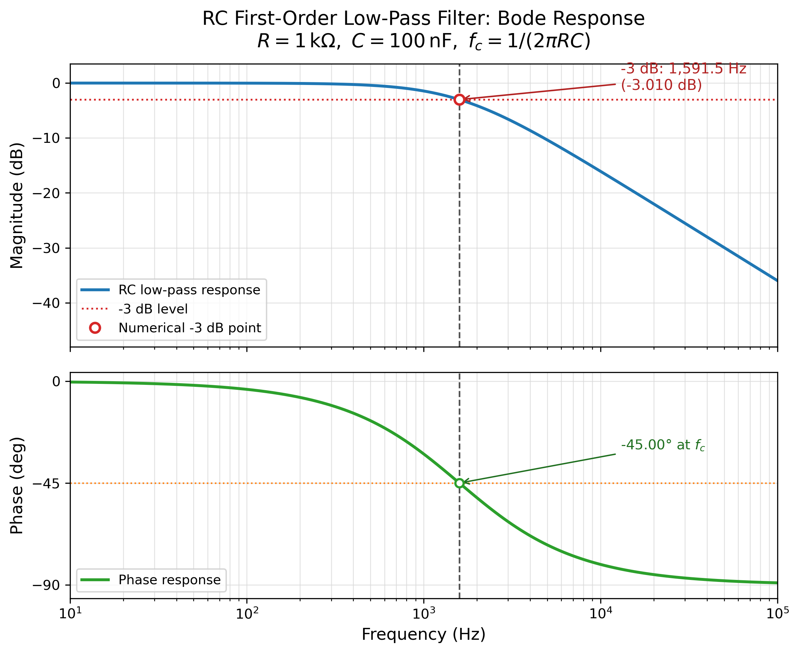

# RC 一阶低通滤波器幅频特性验证

## 1. 参数与理论计算

- 电阻：\(R=1\,\mathrm{k}\Omega=1000\,\Omega\)
- 电容：\(C=100\,\mathrm{nF}=100\times10^{-9}\,\mathrm{F}\)
- 时间常数：

\[
\tau=RC=(1000)(100\times10^{-9})=1.00\times10^{-4}\,\mathrm{s}
\]

- 截止角频率：

\[
\omega_c=\frac{1}{\tau}=10000\,\mathrm{rad/s}
\]

- 理论截止频率：

\[
f_c=\frac{1}{2\pi RC}
=\frac{1}{2\pi(1000)(100\times10^{-9})}
\approx 1591.549\,\mathrm{Hz}
\]

一阶低通滤波器的传递函数为：

\[
H(j\omega)=\frac{1}{1+j\omega RC}
=\frac{1}{1+j(f/f_c)}
\]

其幅频和相频特性分别为：

\[
|H(f)|=\frac{1}{\sqrt{1+(f/f_c)^2}},
\qquad
\varphi(f)=-\arctan\left(\frac{f}{f_c}\right)
\]

## 2. 数值扫频方法

- 频率范围：\(10\,\mathrm{Hz}\) 至 \(100\,\mathrm{kHz}\)
- 扫描方式：对数等间隔，共 5001 个频点
- 幅频结果：\(20\log_{10}|H(f)|\)，单位 dB
- 相频结果：\(\angle H(f)\)，单位度
- \(-3\,\mathrm{dB}\) 点：在扫频结果中寻找幅值穿越 \(-3.0103\,\mathrm{dB}\) 的位置，并在对数频率轴上作线性插值

## 3. 结果

| 项目 | 数值 |
|---|---:|
| 理论截止频率 \(f_c\) | 1591.549 Hz |
| 数值扫频得到的 \(-3\,\mathrm{dB}\) 频率 | 1591.549 Hz |
| 绝对偏差 | -0.00054 Hz |
| 相对偏差 | \(-3.38\times10^{-5}\%\) |
| 截止点幅值 | -3.0103 dB |
| 截止点相位 | -45.000° |
| 10 Hz 幅值 / 相位 | -0.00017 dB / -0.360° |
| 100 kHz 幅值 / 相位 | -35.965 dB / -89.088° |
| 高频衰减斜率 | 约 -20 dB/十倍频 |

数值扫频得到的 \(-3\,\mathrm{dB}\) 频率与理论值之间的差异仅来自频率网格和插值误差，约为 \(0.00054\,\mathrm{Hz}\)，可以忽略。

单独曲线：

- [幅频特性](magnitude_response.png)
- [相频特性](phase_response.png)

完整数据见 [frequency_response.csv](frequency_response.csv)，计算指标见 [metrics.json](metrics.json)。

## 4. 结论

1. 该 RC 电路的理论截止频率为 **1591.55 Hz**，数值扫频得到的 \(-3\,\mathrm{dB}\) 点为 **1591.55 Hz**，相对偏差约 **0.000034%**，与理论值一致。
2. 在截止频率处，幅值衰减约 **-3.01 dB**，相位约 **-45°**。
3. 频率升高后，幅频曲线以约 **-20 dB/十倍频** 的斜率下降，相位从 \(0^\circ\) 逐渐趋近 \(-90^\circ\)，符合一阶低通滤波器的典型特性。
4. 因此，给定参数下的 RC 电路确实构成一阶低通滤波器，理论计算与数值扫频结果相互验证。

## 5. 关于“实测”的说明

本次没有提供示波器、扫频仪或电路仿真软件导出的实际测量数据，因此上述“数值扫频结果”不是硬件实测值。若后续提供实测的幅频数据，可用下式计算偏差：

\[
\delta_f=\frac{f_{\mathrm{meas}}-f_c}{f_c}\times100\%
\]

实际电路中的电阻和电容容差、寄生参数、信号源输出阻抗及测量探头负载，都会使硬件测得的截止频率偏离理想值。
